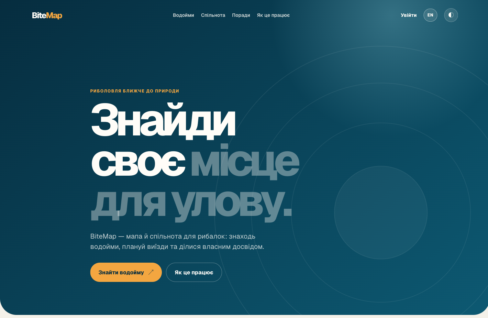
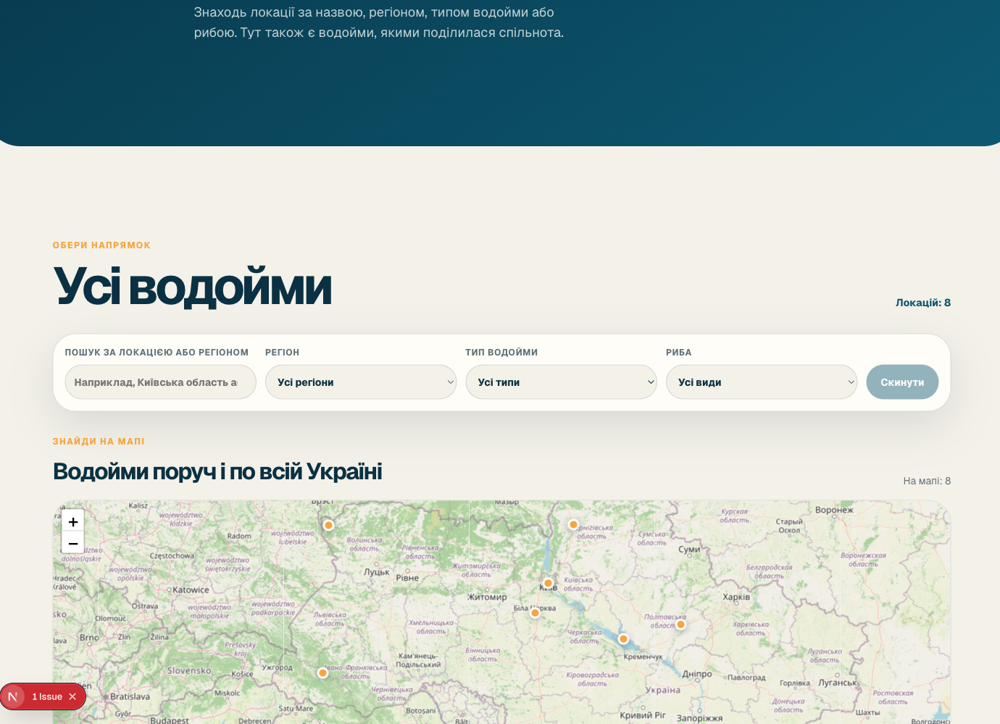

# BiteMap

BiteMap — двомовний вебзастосунок для рибалок і людей, які відпочивають біля
води. Він поєднує мапу водойм, особисті нотатки про місця, звіти з виїздів і
спільноту, де можна обмінюватися практичним досвідом.

Проєкт створено, щоб допомогти знайти водойму, спланувати поїздку та зберегти
корисні спостереження після неї. BiteMap також демонструє розробку сучасного
вебзастосунку на Next.js із локалізацією, Firebase, картами, інтеграцією погоди,
захищеним керуванням контентом та автоматизованими перевірками.

## Скріншоти

Зображення показують інтерфейс українською мовою з демонстраційними локаціями.

<p align="center">
  
  
</p>

## Що можна робити

- **Знаходити водойми:** шукати за назвою та місцевістю, застосовувати фільтри
  за областю, типом водойми й видами риби, переглядати локації на мапі.
- **Планувати виїзд:** переглядати координати, маршрут до водойми, прогноз
  погоди на сім днів і орієнтовний індекс активності риби. Індекс є підказкою
  для планування, а не гарантією улову.
- **Зберігати власні місця:** після реєстрації створювати приватні водойми,
  додавати координати, редагувати їх, а за бажанням публікувати для спільноти.
- **Ділитися досвідом:** додавати до водойм фотографії та звіти про виїзди з
  описом умов, улову, снастей і наживки; редагувати або видаляти власні записи.
- **Спілкуватися:** підписуватися на рибалок, переглядати стрічку їхніх
  оновлень, коментувати звіти та реагувати на публікації й фото.
- **Читати поради:** переглядати двомовні статті про снасті, техніки ловлі та
  планування риболовлі.
- **Керувати добірками й виглядом:** зберігати водойми в обраному та обирати
  світлу або темну тему.
- **Підтримувати якість спільноти:** надсилати скарги на контент; адміністратори
  можуть переглядати скарги й модерувати публікації.

Інтерфейс доступний українською та англійською. Публічні сторінки можна
переглядати без облікового запису; для публікації контенту й особистих функцій
потрібно увійти.

## Як користуватися

1. Відкрий розділ `/uk/spots`, щоб знайти місце через пошук, фільтри або мапу.
2. Перейди на сторінку водойми, щоб переглянути опис, фото, погоду, звіти та
   координати.
3. Увійди або створи акаунт, щоб зберігати водойми, публікувати власні місця,
   фото й звіти, підписуватися на інших учасників.
4. Відкрий `/uk/community`, `/uk/feed` або `/uk/articles`, щоб познайомитися з
   публікаціями інших рибалок.

Посилання в інтерфейсі автоматично зберігають вибрану мову (`/uk` або `/en`).

## Технології

- **Next.js 16 App Router**, **React 19**, **TypeScript** — інтерфейс,
  маршрутизація та серверні API-маршрути.
- **Feature-Sliced Design** — організація коду за шарами та відповідальністю.
- **Firebase Authentication** — вхід через Google та email із паролем;
  **Cloud Firestore** — профілі, водойми, звіти, спільнота й правила доступу.
- **Cloudinary** — зображення з підписаним сервером завантаженням.
- **Leaflet**, **React Leaflet**, **OpenStreetMap** — інтерактивні карти;
  **Open-Meteo API** — прогноз погоди.
- **next-intl** — українська й англійська локалізації.
- **SCSS Modules** — стилі компонентів; **Tiptap** — редактор статей;
  **DOMPurify** — очищення форматованого HTML.
- **Playwright**, **Firebase Emulator Suite**, **Node.js test runner** —
  браузерні, правила доступу й unit-перевірки; **GitHub Actions** запускає їх
  автоматично разом із lint, перевіркою TypeScript і production build.

## Структура проєкту

```text
src/
├── app/         # маршрути Next.js, локалі, глобальні стилі та провайдери
├── views/       # композиція екранів BiteMap
├── widgets/     # великі повторно використовувані блоки інтерфейсу
├── features/    # дії користувача: авторизація, фільтри, звіти, фото
├── entities/    # доменні моделі: водойма, користувач, звіт, стаття
└── shared/      # спільні API, бібліотеки, стилі та компоненти

messages/        # переклади інтерфейсу
docs/            # архітектура, налаштування Firebase та внутрішні нотатки
tests/           # unit-, Firestore rules- та e2e-тести
```

Детальні правила шарів і приклади імпортів описані в
[`docs/architecture.md`](docs/architecture.md).

## Запуск для розробки

Потрібні Node.js, Firebase Web configuration і ключі Cloudinary. Створи `.env.local`
на основі [`.env.example`](.env.example), заповни значення та налаштуй сервіси за
інструкцією у [`docs/firebase-setup.md`](docs/firebase-setup.md).

```bash
npm ci
npm run dev
```

Відкрий [http://localhost:3000/uk](http://localhost:3000/uk). Налаштування
правил і доступу описані у [`docs/firestore-security.md`](docs/firestore-security.md).

## Перевірки

```bash
npm run lint
npm test
npm run test:rules
npm run test:e2e
npm run build
```

Firebase Emulator для `test:rules` і `test:e2e` потребує Java 21; браузерний
сценарій також потребує Chromium (`npx playwright install chromium`). E2E
перевіряє реєстрацію, створення приватної водойми, публікацію звіту, коментар,
підписку та появу звіту у стрічці. GitHub Actions автоматично запускає
перевірки для змін у `main` і pull request.

## Розгортання

BiteMap працює на Node.js-хостингу Hostinger за адресою
[bitemap.artemlira.com](https://bitemap.artemlira.com/uk). GitHub Actions
перевіряє pull request до `main` і кожен push у `main`. Після злиття PR
Hostinger автоматично збирає та розгортає новий коміт з `main`.
Налаштування середовища, перевірка збірки й обмеження цього процесу описані в
[`docs/hostinger-deployment.md`](docs/hostinger-deployment.md).
